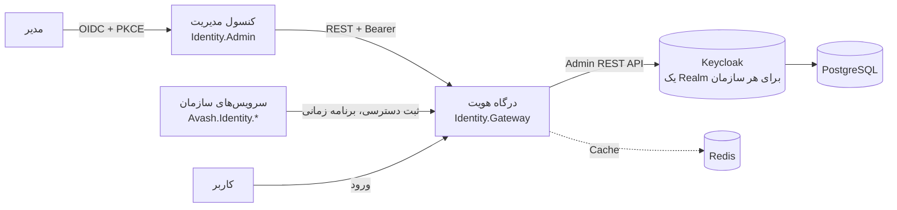

# درگاه هویت آواش (Identity Gateway)

درگاه هویت آواش یک لایه .NET بدون پایگاه داده روی Keycloak است. Keycloak را از دید کاربران و مدیران پنهان می‌کند، ولی بیشتر امکاناتش را از طریق APIهای یکپارچه و یک کنسول مدیریت فارسی در اختیار سازمان می‌گذارد.

- [معرفی](#معرفی)
- [قابلیت‌ها](#قابلیتها)
- [معماری در یک نگاه](#معماری-در-یک-نگاه)
- [شروع سریع](#شروع-سریع)
- [کنسول مدیریت](#کنسول-مدیریت)
- [اتصال یک سرویس](#اتصال-یک-سرویس)
- [تست‌ها](#تستها)
- [افزودن سازمان جدید](#افزودن-سازمان-جدید)
- [مستندات بیشتر](#مستندات-بیشتر)
- [محدودیت‌های شناخته‌شده](#محدودیتهای-شناختهشده)

## معرفی

مدیر سیستم، مدیر فناوری یا مدیری که مدیریت بخشی از سازمان به او سپرده شده، از این سامانه برای این کارها استفاده می‌کند:

- تعریف اپلیکیشن‌ها و سرویس‌ها و دسترسی‌های هر کدام؛
- تعریف نقش‌های سازمانی و دادن دسترسی به آن‌ها به‌صورت درختی (اپلیکیشن ← ماژول ← منبع ← عمل)؛
- تعریف کاربر و محدود کردن او به بخشی از داده‌ها (مثلاً استان، شهر یا شعبه)؛
- تعیین برنامه زمانی هفتگی برای نقش، دسترسی یا کاربر؛
- مدیریت روش‌های ورود: ورود مستقیم، SSO با صفحه ورود اختصاصی هر اپلیکیشن، LDAP و Active Directory، ورود دومرحله‌ای.

همه داده‌ها در Keycloak ذخیره می‌شوند. درگاه پایگاه داده‌ای ندارد و Redis فقط نقش Cache را دارد.

## قابلیت‌ها

| قابلیت | توضیح |
|---|---|
| اپلیکیشن و دسترسی | هر اپلیکیشن یک Client در Keycloak است. دسترسی‌ها به شکل `App:Module:Resource:Action` نام‌گذاری می‌شوند و سرویس‌ها می‌توانند دسترسی‌های خود را خودکار ثبت کنند. |
| نقش سازمانی | هر نقش یک Group است. دسترسی‌ها با درخت و «انتخاب همه» در هر سطح، یا «همه دسترسی‌های خواندنی یک اپلیکیشن» انتخاب می‌شوند. |
| محدوده داده | کلیدهای محدوده (مثل `province` و `city`) با سلسله‌مراتب والد و فرزند و فهرست مقادیر مجاز تعریف می‌شوند و روی کاربر ثبت می‌شوند. |
| مدیریت تفویضی | هر نقش می‌تواند محدوده‌های الزامی داشته باشد. مدیر تفویضی فقط کاربران محدوده خودش را می‌بیند و فقط دسترسی‌هایی را می‌دهد که خودش دارد. |
| برنامه زمانی | برنامه هفتگی روی سازمان، نقش، دسترسی یا کاربر، با اولویت کاربر ← دسترسی ← نقش ← سازمان. ورود، تمدید توکن و سرویس‌ها خارج از برنامه رد می‌شوند. |
| چرخه کاربر | ایجاد، ویرایش، رمز عبور، رفع قفل، حذف رمز یک‌بارمصرف، اقدامات الزامی، نشست‌ها. |
| تنظیمات احراز هویت | عمر توکن و نشست، سیاست رمز عبور، قفل حساب، ورود دومرحله‌ای، صفحه ورود فارسی، سرویس‌های ورود خارجی، LDAP و Active Directory. |
| چندسازمانی | هر سازمان یک Realm جدا در Keycloak است. توکن هر سازمان فقط برای همان سازمان معتبر است. |
| کنسول مدیریت | کنسول فارسی و راست‌به‌چپ با Radzen Blazor که منوها را بر اساس دسترسی‌های مدیر نشان می‌دهد. |

## معماری در یک نگاه



جزئیات در [معماری](docs/architecture.md) آمده است.

## شروع سریع

پیش‌نیاز: ‏.NET 10 SDK و Docker. سپس:

```bash
dotnet build IdentityService.slnx
dotnet run --project src/Identity.AppHost --launch-profile http
```

| سرویس | آدرس |
|---|---|
| کنسول مدیریت | `http://localhost:5090` |
| درگاه هویت | `http://localhost:5080` |
| ‏Keycloak | `https://localhost:18080` |
| داشبورد Aspire | `http://localhost:15140` |
| سرویس نمونه | `http://localhost:5081` |

کاربر پیش‌فرض محیط توسعه `admin` با رمز `admin` در هر دو سازمان `company` و `acme` است. راهنمای کامل اجرا در [راهنمای اجرا](docs/running.md) است.

## کنسول مدیریت

‏`http://localhost:5090` را باز کنید، سازمان را انتخاب کنید و در صفحه ورود فارسی Keycloak وارد شوید. بخش‌های کنسول:

- داشبورد، کاربران، نقش‌ها، اپلیکیشن‌ها و دسترسی‌ها؛
- محدوده‌ها و مقادیر مجاز، برنامه زمانی پیش‌فرض سازمان؛
- تنظیمات احراز هویت و فهرست سازمان‌ها.

هر بخش فقط برای مدیری نمایش داده می‌شود که دسترسی خواندن آن را دارد.

## اتصال یک سرویس

یک سرویس با بسته‌های `Avash.Identity.*` به درگاه وصل می‌شود:

```csharp
builder.Services.AddAvashAuthentication(o =>
{
    o.Authority = "http://localhost:5080";          // درگاه، نه Keycloak
    o.AcceptIssuerFromDiscovery = true;
});
builder.Services.AddAvashAuthorization(o => o.ApplicationId = "order-service");
builder.Services.AddAvashAccessSchedules(o => o.GatewayBaseUrl = "http://localhost:5080");
builder.Services.AddPermissionRegistration(o =>
{
    o.IdentityServer = new Uri("http://localhost:5080");
    o.ServiceName = "order-service";
    o.ClientId = "order-service";
    o.ClientSecret = builder.Configuration["PermissionRegistration:ClientSecret"];
});

app.MapGet("/api/orders", ListOrders).RequireAuthorization("Orders:Order:View");
```

نمونه کامل در [`samples/OrderService.Sample`](samples/OrderService.Sample/) است. فهرست درخواست‌های API در [`Identity.Gateway.http`](src/Identity.Gateway/Identity.Gateway.http) و [خلاصه API](docs/api.md) آمده است.

## تست‌ها

```bash
dotnet test IdentityService.slnx                          # تست‌های واحد و یکپارچگی
IDENTITY_E2E=1 dotnet test tests/Identity.E2E.Tests       # تست‌های سرتاسری روی Stack واقعی
bash scripts/smoke-test.sh                                # سناریوی کسب‌وکار روی Stack در حال اجرا
```

تست‌های سرتاسری خودشان Stack را با `Aspire.Hosting.Testing` بالا می‌آورند. برای اجرای آن‌ها Docker لازم است و Stack توسعه باید خاموش باشد.

## افزودن سازمان جدید

ابزار `tools/Identity.TenantProvisioning` با حساب Realm اصلی Keycloak یک Realm کامل برای سازمان جدید می‌سازد و تنظیمات درگاه و کنسول را با رمزهای تصادفی تحویل می‌دهد. جزئیات در [راهنمای اجرا](docs/running.md) است.

## مستندات بیشتر

- [معماری و مدل داده در Keycloak](docs/architecture.md)
- [راهنمای اجرا و عیب‌یابی](docs/running.md)
- [خلاصه API](docs/api.md)
- ‏[CLAUDE.md](CLAUDE.md): راهنمای توسعه و تصمیم‌های الزام‌آور معماری

مجموعه Postman در پوشه `postman` قدیمی است و نام دسترسی‌های قبلی را دارد؛ مرجع به‌روز فایل `Identity.Gateway.http` است.

## محدودیت‌های شناخته‌شده

- ورود با پیامک هنوز پیاده‌سازی نشده است و هر وقت لازم شد اضافه می‌شود.
- برای اعمال برنامه زمانی روی صفحه ورود خود Keycloak باید افزونه `keycloak/extensions` ساخته شود (`bash scripts/build-keycloak-extensions.sh`، فقط با Docker). نشست SSO که از قبل باز است، تا پایان زمان بیکاری دوباره بررسی نمی‌شود.
- کنسول توکن‌ها را در حافظه سرور نگه می‌دارد؛ با راه‌اندازی دوباره کنسول، مدیران باید دوباره وارد شوند.
