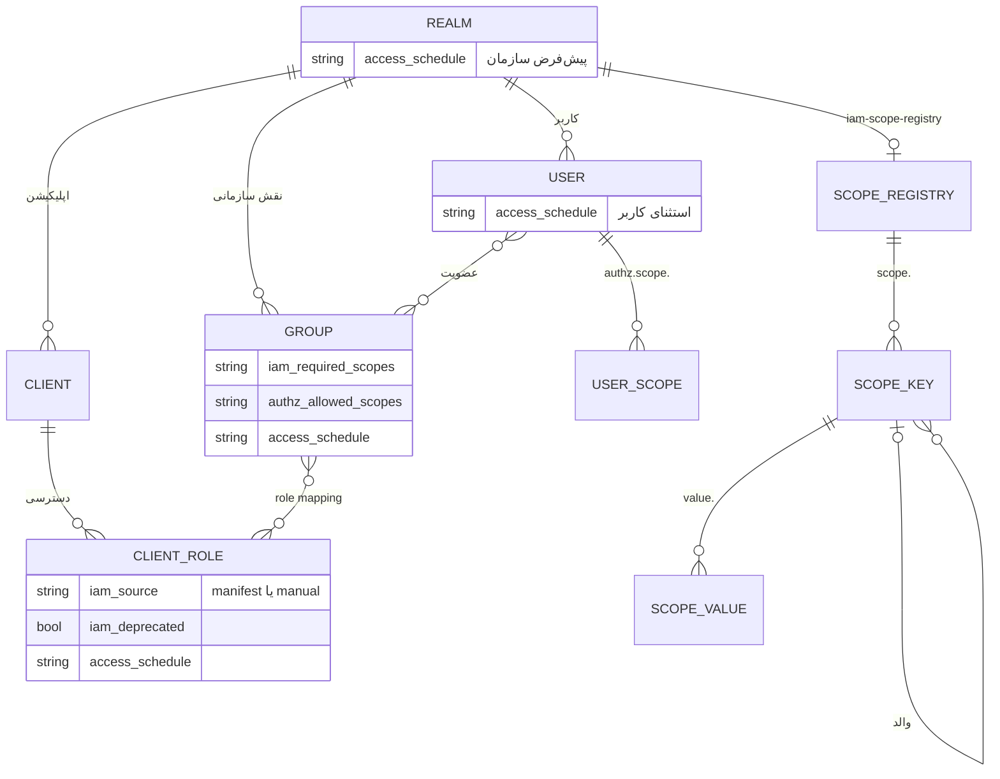
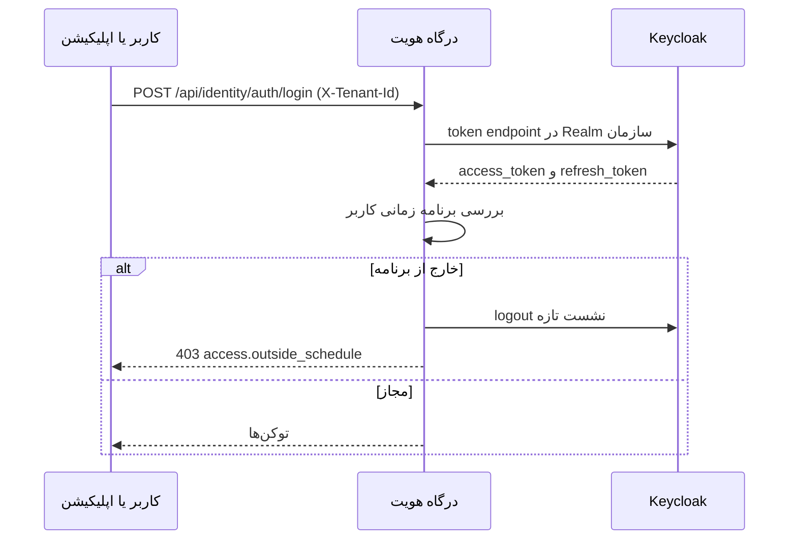
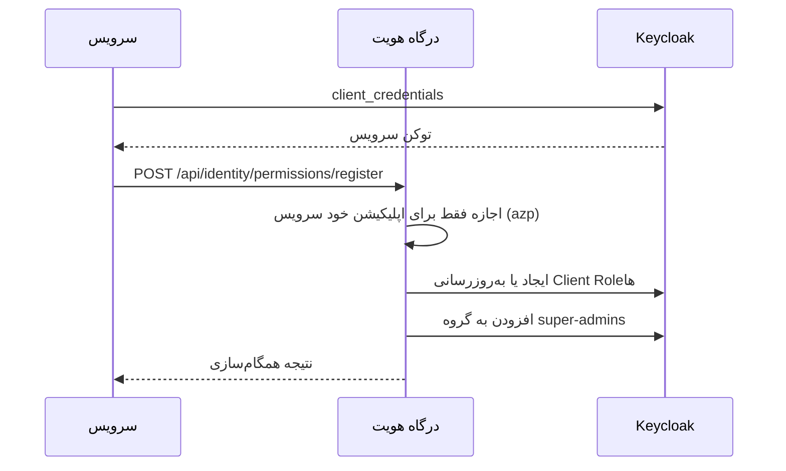

# معماری درگاه هویت

این سند ساختار درگاه هویت، مدل داده آن در Keycloak و جریان‌های اصلی را توضیح می‌دهد.

- [اصول و تصمیم‌های الزام‌آور](#اصول-و-تصمیمهای-الزامآور)
- [پروژه‌ها و لایه‌ها](#پروژهها-و-لایهها)
- [مدل داده در Keycloak](#مدل-داده-در-keycloak)
- [نام‌گذاری دسترسی‌ها](#نامگذاری-دسترسیها)
- [محدوده‌ها و مدیریت تفویضی](#محدودهها-و-مدیریت-تفویضی)
- [برنامه زمانی هفتگی](#برنامه-زمانی-هفتگی)
- [چندسازمانی](#چندسازمانی)
- [جریان‌های اصلی](#جریانهای-اصلی)
- [مدل خطا](#مدل-خطا)
- [امنیت](#امنیت)
- ‏[Cache](#cache)

## اصول و تصمیم‌های الزام‌آور

- ‏Keycloak تنها محل ذخیره داده است. درگاه پایگاه داده ندارد؛ اپلیکیشن، دسترسی، نقش، محدوده، برنامه زمانی و تنظیمات همه موجودیت‌ها و ویژگی‌های Keycloak هستند. Redis فقط Cache است.
- درگاه هیچ‌وقت توکن نمی‌سازد و رمز عبور نگه نمی‌دارد. توکن‌ها را Keycloak صادر و امضا می‌کند و کلیدهای امضا هم در Keycloak مدیریت می‌شوند.
- پایگاه داده Keycloak، ‏PostgreSQL است و اجرای محلی با .NET Aspire انجام می‌شود.
- هر سازمان یک Realm است. هر فراخوانی Keycloak از Realm سازمان جاری استفاده می‌کند.
- خطاها پنهان نمی‌شوند: هر خطای Keycloak به ProblemDetails با کد پایدار و شناسه پیگیری تبدیل می‌شود و بدنه خام Keycloak به بیرون نمی‌رود.
- نوشتن در Admin API کلیدکول تکرارپذیر نیست؛ بنابراین POST، ‏PUT و DELETE هیچ‌وقت خودکار تکرار نمی‌شوند.

## پروژه‌ها و لایه‌ها

| پروژه | نقش |
|---|---|
| ‏`Identity.AppHost` | میزبان Aspire: ‏PostgreSQL، ‏Keycloak با Import دو Realm و تم فارسی، Redis، درگاه، کنسول و سرویس نمونه |
| ‏`Identity.Gateway` | ‏Minimal API، مدل خطا، احراز هویت چند صادرکننده، چندسازمانی، Bootstrap کلیدکول |
| ‏`Identity.Admin` | کنسول مدیریت فارسی با Radzen Blazor |
| ‏`Identity.Application` | منطق کاربرد: هماهنگ‌سازی کاربر و نقش، تفویض، اعتبارسنجی محدوده، برنامه زمانی |
| ‏`Identity.Contracts` | ‏DTOها و قالب برنامه زمانی که بین درگاه و سرویس‌ها مشترک است |
| ‏`Identity.Infrastructure.Keycloak` | آداپترهای Admin API کلیدکول |
| ‏`Avash.Identity.*` | بسته‌های سرویس‌ها: احراز هویت، مجوز، زمینه دسترسی، ثبت دسترسی‌ها، برنامه زمانی |

وابستگی‌ها از بیرون به داخل است: Gateway به Application و Infrastructure، و Application فقط به Domain و Contracts وابسته است. تست‌های معماری این قاعده را بررسی می‌کنند.

## مدل داده در Keycloak

| مفهوم | موجودیت Keycloak | جزئیات |
|---|---|---|
| سازمان | ‏Realm | تنظیمات احراز هویت روی Realm؛ برنامه زمانی پیش‌فرض در ویژگی `access.schedule` |
| اپلیکیشن | ‏Client | ویژگی‌های `iam.application`، ‏`iam.display_name`، ‏`iam.kind` و صفحه ورود در `login_theme` |
| دسترسی | ‏Client Role | نام `Module:Resource:Action`؛ در توکن به شکل `App:Module:Resource:Action`؛ منبع ثبت و منسوخ‌بودن در ویژگی‌ها |
| نقش سازمانی | ‏Group | دسترسی‌ها با Role Mapping؛ محدوده‌های الزامی در `iam.required_scopes` و مجاز در `authz.allowed-scopes` |
| کلید محدوده | ویژگی‌های گروه `iam-scope-registry` | تعریف کلید، والد و فهرست مقادیر مجاز |
| محدوده کاربر | ویژگی‌های کاربر `authz.scope.<key>` | در توکن به‌صورت تودرتو: `authz.scope.region` |
| برنامه زمانی | ویژگی `access.schedule` | روی Realm، ‏Group، ‏Client Role یا کاربر |
| مدیر ارشد | گروه `super-admins` | همیشه وجود دارد و همه دسترسی‌های اپلیکیشن‌ها را دارد |

## نام‌گذاری دسترسی‌ها

هر دسترسی چهار بخش دارد: `اپلیکیشن:ماژول:منبع:عمل`، مثلاً `order-service:Orders:Invoice:View`. کنسول از همین بخش‌ها درخت انتخاب را می‌سازد و با تیک زدن هر سطح، همه دسترسی‌های زیر آن انتخاب می‌شوند. دکمه «همه دسترسی‌های خواندنی» عمل‌هایی را که با `Read`، ‏`View`، ‏`List` یا `Get` شروع می‌شوند انتخاب می‌کند.

سرویس‌ها دسترسی‌های خود را هنگام شروع ثبت می‌کنند (`POST /api/identity/permissions/register`). هر سرویس فقط دسترسی‌های اپلیکیشن خودش را ثبت می‌کند و دسترسی‌هایی که دیگر ثبت نمی‌شوند منسوخ علامت می‌خورند، نه حذف. دسترسی دستی هم از کنسول اضافه می‌شود.

## محدوده‌ها و مدیریت تفویضی

- هر کلید محدوده می‌تواند والد داشته باشد (شهر ← استان) و فهرست مقادیر مجاز. مقدار فرزند باید به یکی از مقادیر والدِ همان تخصیص تعلق داشته باشد.
- نقش می‌تواند کلیدهای الزامی داشته باشد. مثلاً «مدیر تهران» استان و شهر را الزامی دارد و منطقه را اختیاری؛ برای کلید الزامی مقدار `*` (همه) پذیرفته نمی‌شود.
- مدیری که عضو `super-admins` نیست، مدیر تفویضی است:
  - فقط دسترسی‌هایی را می‌دهد که خودش دارد؛
  - فقط کاربرانی را می‌بیند و تغییر می‌دهد که در محدوده خودش هستند؛
  - فقط مقادیری از محدوده را تخصیص می‌دهد که خودش دارد.

## برنامه زمانی هفتگی

قالب ذخیره‌سازی فشرده است، مثلاً `sat=08:00-16:00;sun=08:00-12:00,14:00-18:00` یا `unrestricted`. روزی که ذکر نشود دسترسی ندارد و زمان‌ها در منطقه زمانی سازمان (`Identity:Schedules:TimeZone`، پیش‌فرض `Asia/Tehran`) هستند.

اولویت: کاربر ← دسترسی ← نقش ← سازمان. نقشی که برنامه ندارد از برنامه سازمان پیروی می‌کند و کاربری که چند نقش دارد در بازه‌ای که هر کدام از نقش‌هایش مجاز باشد می‌تواند کار کند.

اعمال برنامه در سه جا انجام می‌شود:

1. ورود و تمدید توکن در درگاه؛ خارج از برنامه، نشست تازه Keycloak هم بسته می‌شود.
2. سرویس‌هایی که `AddAvashAccessSchedules` را فراخوانی کرده‌اند، هر دسترسی را با برنامه مؤثر آن بررسی می‌کنند. اگر برنامه خوانده نشود، دسترسی رد می‌شود.
3. کنسول برنامه مؤثر هر کاربر را نمایش می‌دهد.

## چندسازمانی

- سازمان پیش‌فرض از تنظیمات `Identity:KeycloakAdmin` و سازمان‌های دیگر از فهرست `Identity:Tenants` خوانده می‌شوند. یک سازمان بزرگ می‌تواند خوشه Keycloak خودش را داشته باشد (`BaseUrl`).
- درخواست با سرآیند `X-Tenant-Id` سازمان را انتخاب می‌کند؛ بدون آن، سازمان پیش‌فرض.
- توکن هر Realm فقط برای همان سازمان پذیرفته می‌شود و در غیر این صورت پاسخ `403 tenant.mismatch` است.
- ‏Bootstrap درگاه (رجیستری محدوده، Mapperهای توکن، گروه `super-admins`، دسترسی‌های درگاه، کلاینت کنسول) برای همه سازمان‌ها اجرا می‌شود.

## جریان‌های اصلی

ورود مستقیم از طریق درگاه:

ثبت دسترسی‌های یک سرویس:

## مدل خطا

پاسخ خطا قالب RFC 9457 دارد و یک `code` پایدار و `traceId` به آن اضافه می‌شود:

| نوع | وضعیت HTTP | نمونه کد |
|---|---|---|
| اعتبارسنجی | 400 | `request.invalid`، ‏`scope.invalid_parent_value` |
| یافت نشد | 404 | `user.not_found`، ‏`role.not_found` |
| تداخل | 409 | `role.already_exists` |
| ممنوع | 403 | `delegation.scope_outside_admin`، ‏`access.outside_schedule`، ‏`tenant.mismatch` |
| در دسترس نبودن | 503 | `keycloak.unreachable` |
| خطای سرویس بالادستی | 502 | `user.email_not_sent` |

## امنیت

- درگاه با یک Service Account محدود (`identity-gateway-admin`) و نه با کاربر ارشد Realm `master` به Keycloak وصل می‌شود.
- ویژگی‌های `authz.*`، ‏`iam.*` و `access.*` فقط از APIهای مخصوص خودشان نوشته می‌شوند و کاربر از طریق حساب خودش نمی‌تواند تغییرشان دهد (اعلام آن‌ها در User Profile با دسترسی فقط مدیر).
- رمزهای Client، ‏Bind Password در LDAP و کلیدهای سرویس‌های ورود خارجی هیچ‌وقت برگردانده نمی‌شوند.
- حذف اتصال LDAP به تأیید صریح (`?confirm=true`) نیاز دارد، چون Keycloak کاربران واردشده از آن را هم حذف می‌کند.
- کنسول توکن‌ها را فقط در سرور نگه می‌دارد و Cookie آن HttpOnly است.

## ‏Cache

| داده | محل | مدت |
|---|---|---|
| توکن Service Account | حافظه درگاه، به تفکیک Realm | تا کمی پیش از انقضا |
| رجیستری محدوده‌ها | حافظه و Redis، به تفکیک Realm | کوتاه؛ با هر تغییر پاک می‌شود |
| برنامه زمانی مؤثر کاربر | حافظه درگاه، به تفکیک سازمان | ۳۰ ثانیه؛ با هر تغییر پاک می‌شود |
| برنامه زمانی در سرویس‌ها | حافظه سرویس | یک دقیقه (`AccessScheduleClientOptions.CacheDuration`) |
