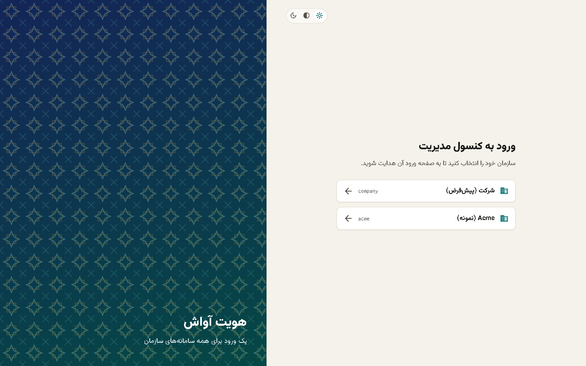
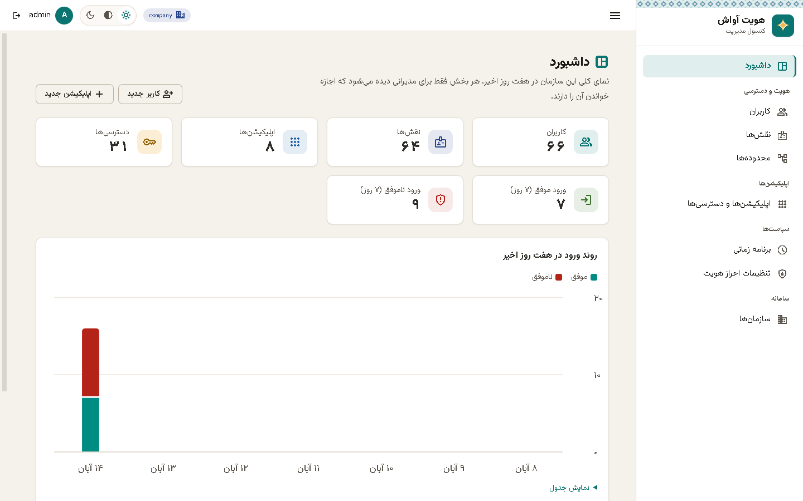
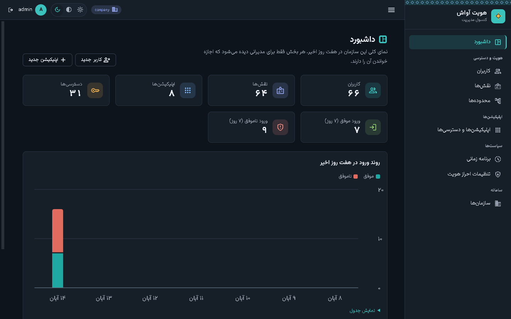
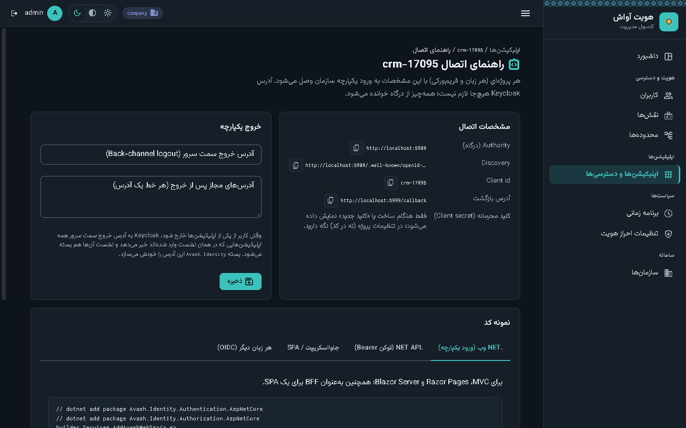

# راهنمای کنسول مدیریت

کنسول مدیریت (`http://localhost:5090` در محیط توسعه) برای مدیران سازمان است: کاربران، نقش‌ها، محدوده‌ها، اپلیکیشن‌ها، برنامه زمانی و تنظیمات ورود. هر بخش فقط برای مدیرانی دیده می‌شود که دسترسی خواندن آن را دارند و دکمه‌های تغییر فقط برای کسانی که دسترسی مدیریت دارند.

- [ورود به کنسول](#ورود-به-کنسول)
- [ظاهر و حالت نمایش](#ظاهر-و-حالت-نمایش)
- [داشبورد](#داشبورد)
- [بخش‌ها](#بخشها)
- [رویدادها و ممیزی](#رویدادها-و-ممیزی)
- [دسترسی‌های کنسول](#دسترسیهای-کنسول)
- [برای توسعه‌دهندگان کنسول](#برای-توسعهدهندگان-کنسول)

## ورود به کنسول

صفحه اول فهرست سازمان‌هاست. با انتخاب سازمان، صفحه ورود همان سازمان باز می‌شود. پس از ورود، همه کارها در همان سازمان انجام می‌شود؛ برای مدیریت سازمان دیگر خارج شوید و آن را انتخاب کنید. اگر ورود رد شود (مثلاً خارج از برنامه زمانی)، به همین صفحه برمی‌گردید و پیام فارسی می‌بینید.

## ظاهر و حالت نمایش

- رنگ‌ها از کاشی‌کاری ایرانی گرفته شده است: فیروزه‌ای برای کارهای اصلی، لاجوردی، زعفرانی برای هشدار، اناری برای خطا و پسته‌ای برای موفقیت، روی زمینه کاهگلی (روشن) یا شب نیلی (تیره). کنتراست همه متن‌ها دست‌کم ۴٫۵ به ۱ است.
- فونت وزیرمتن روی خود سرور است و به اینترنت نیاز ندارد. اعداد با ارقام فارسی و تاریخ‌ها شمسی و به وقت تهران نمایش داده می‌شود.
- کلید سه‌حالته بالای صفحه: روشن، مطابق سیستم و تیره. انتخاب در کوکی می‌ماند و صفحه از همان اول با رنگ درست باز می‌شود.

## داشبورد

- کارت‌های کاربران، نقش‌ها، اپلیکیشن‌ها و دسترسی‌ها، ورود موفق و ناموفق هفت روز اخیر. با زدن هر کارت به همان بخش می‌روید.
- نمودار روند ورود: هر ستون یک روز (از راست به چپ، قدیمی‌ترین در راست)؛ بخش پایین ورود موفق و بخش بالا ناموفق است. با ماوس یا کلید Tab روی هر روز، عدد دقیق را می‌بینید و «نمایش جدول» همان اعداد را جدولی نشان می‌دهد.
- پرکاربردترین اپلیکیشن‌ها و آخرین تغییرات مدیریتی (ایجاد، ویرایش و حذف کاربر، نقش، اپلیکیشن و تنظیمات).
- اگر یک بخش خوانده نشود، فقط همان بخش «—» یا پیام خطا نشان می‌دهد و بقیه کار می‌کنند. اگر ثبت رویدادها خاموش باشد، داشبورد توضیح می‌دهد و مدیر تنظیمات پیوند روشن کردنش را می‌بیند.

## بخش‌ها

| بخش | کار |
|---|---|
| کاربران | جستجو، ساخت کاربر با نقش و محدوده، شماره موبایل برای ورود با پیامک، قفل و باز کردن، بازنشانی رمز و ورود دومرحله‌ای، نشست‌ها، برنامه زمانی اختصاصی |
| نقش‌ها | دسترسی‌ها (درخت با «انتخاب همه» در هر سطح)، محدوده‌های الزامی و مجاز، برنامه زمانی نقش |
| محدوده‌ها | کلیدها (مثل استان و شهر)، والد و مقادیر مجاز |
| اپلیکیشن‌ها و دسترسی‌ها | اپلیکیشن‌ها، کلید محرمانه، دسترسی‌ها، [صفحه ورود](login-pages.md) و [راهنمای اتصال](integration.md) هر اپلیکیشن |
| برنامه زمانی | برنامه پیش‌فرض سازمان و ترتیب اولویت (کاربر، دسترسی، نقش، سازمان) |
| تنظیمات احراز هویت | توکن و نشست، رمز عبور، قفل حساب، ورود دومرحله‌ای، صفحه ورود، سرویس‌های ورود بیرونی، LDAP و Active Directory، [پیامک](sms.md) و [ورود با پیامک](sms-login.md)، رویدادها و ممیزی |
| سازمان‌ها | فهرست سازمان‌ها (Realmها) |

راهنمای اتصال هر اپلیکیشن، مشخصات و نمونه کد آماده دارد:

## رویدادها و ممیزی

رویدادها در خود Keycloak ثبت می‌شوند. در «تنظیمات احراز هویت ← رویدادها و ممیزی» این گزینه‌ها هست:

- ثبت رویدادهای ورود، خروج و ورود ناموفق
- ثبت تغییرات مدیریتی
- ذخیره جزئیات هر تغییر (ممکن است داده شخصی داشته باشد؛ پیش‌فرض خاموش)
- مدت نگهداری رویدادهای ورود (۱ تا ۳۶۵ روز؛ پیش‌فرض ۳۰ روز)

در سازمان‌های تازه، ثبت هر دو نوع رویداد از ابتدا روشن است.

## دسترسی‌های کنسول

| دسترسی | بخش |
|---|---|
| ‏`identity-gateway:Users:User:Read` و `Manage` | کاربران |
| ‏`identity-gateway:Roles:Role:Read` و `Manage` | نقش‌ها |
| ‏`identity-gateway:Scopes:Scope:Read` و `Manage` | محدوده‌ها |
| ‏`identity-gateway:Applications:Application:Read` و `Manage` | اپلیکیشن‌ها، صفحه ورود و راهنمای اتصال |
| ‏`identity-gateway:Applications:Permission:Read` و `Manage` | دسترسی‌های اپلیکیشن‌ها |
| ‏`identity-gateway:Access:Schedule:Read` و `Manage` | برنامه زمانی |
| ‏`identity-gateway:Settings:Realm:Read` و `Manage` | تنظیمات احراز هویت و رویدادها |
| ‏`identity-gateway:System:Audit:Read` | ورودها و تغییرات در داشبورد |
| ‏`identity-gateway:System:Diagnostics:Read` | سازمان‌ها |

گروه `super-admins` همیشه همه این دسترسی‌ها را دارد. مدیر تفویضی فقط کاربران محدوده خودش را می‌بیند و فقط چیزی را می‌دهد که خودش دارد.

## برای توسعه‌دهندگان کنسول

- رنگ‌ها فقط از توکن‌های `--av-*` در `src/Hosts/Identity.Admin/wwwroot/css/theme.css` خوانده می‌شود؛ هیچ رنگی در کامپوننت‌ها ثابت نوشته نمی‌شود.
- اجزای مشترک در `Components/Shared`: ‏`PageHeader`، ‏`StatCard`، ‏`EmptyState`، ‏`ThemeSwitch`، ‏`Girih` و `LoginTrendChart`.
- اعداد و تاریخ‌ها با `PersianFormat` نمایش داده می‌شود.
- روی متن فارسی `letter-spacing` و `uppercase` نگذارید؛ اتصال حروف را می‌شکند.
- پس از ارتقای Radzen.Blazor، دستور `python scripts/generate-radzen-dark-css.py` را اجرا کنید.
- تست‌های کنسول (bUnit) در `tests/Identity.Admin.Tests` هستند و همه حالت‌ها (بارگذاری، خالی، خطا، ناقص، موفق و بدون دسترسی) را پوشش می‌دهند.
- همه بخش‌ها با صفحه‌کلید کار می‌کنند: اولین Tab لینک «رفتن به محتوای اصلی» است، روی هر عنصر فوکوس‌شده نشانه دیده می‌شود، روزهای نمودار با Tab و کلید تم با Enter و Space کار می‌کنند.
- برچسب شناور `RadzenFormField` متن placeholder را پنهان می‌کند؛ نمونه و راهنما را زیر فیلد بنویسید.
