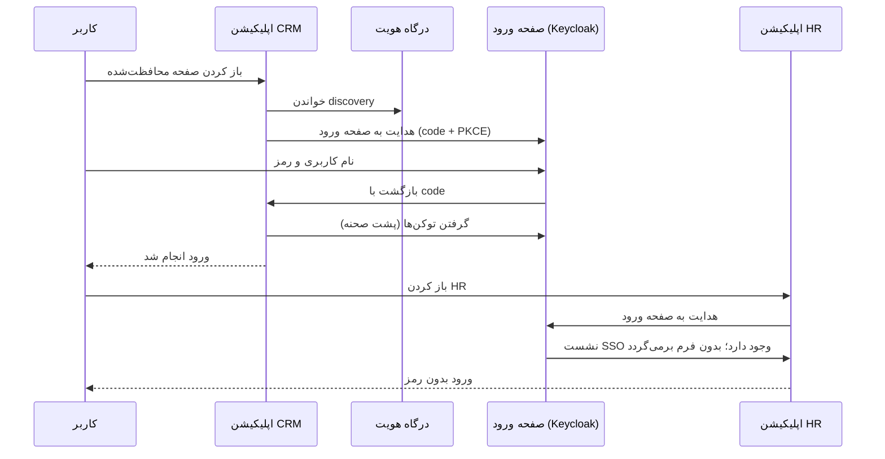

# راهنمای اتصال پروژه‌ها به درگاه هویت

این راهنما برای برنامه‌نویسانی است که می‌خواهند یک پروژه (سرویس، وب‌اپلیکیشن، SPA یا هر زبان دیگری) را به ورود یکپارچه سازمان وصل کنند. همه مقادیری که اینجا لازم است، برای هر اپلیکیشن آماده در کنسول هست: «اپلیکیشن‌ها ← راهنمای اتصال».

- [مفاهیم در یک نگاه](#مفاهیم-در-یک-نگاه)
- [قدم اول: ثبت اپلیکیشن](#قدم-اول-ثبت-اپلیکیشن)
- [کدام روش اتصال؟](#کدام-روش-اتصال)
- [وب‌اپلیکیشن .NET با ورود یکپارچه](#وباپلیکیشن-net-با-ورود-یکپارچه)
  - [خروج یکپارچه](#خروج-یکپارچه)
  - [چند نمونه از اپلیکیشن](#چند-نمونه-از-اپلیکیشن)
- [سرویس API در .NET](#سرویس-api-در-net)
  - [ثبت خودکار دسترسی‌ها](#ثبت-خودکار-دسترسیها)
  - [محدوده‌ها و برنامه زمانی](#محدودهها-و-برنامه-زمانی)
- [اپلیکیشن تک‌صفحه‌ای (SPA)](#اپلیکیشن-تکصفحهای-spa)
- [هر زبان دیگر](#هر-زبان-دیگر)
- [ورود از داخل خود اپلیکیشن](#ورود-از-داخل-خود-اپلیکیشن)
- [سرویس به سرویس](#سرویس-به-سرویس)
- [چندسازمانی](#چندسازمانی)
- [چک‌لیست انتشار](#چکلیست-انتشار)
- [عیب‌یابی](#عیبیابی)

## مفاهیم در یک نگاه

| مفهوم | یعنی چه |
|---|---|
| درگاه (Authority) | آدرس درگاه هویت، مثلاً `https://identity.example.com`. پروژه‌ها فقط آدرس درگاه را می‌دانند، نه Keycloak را |
| اپلیکیشن | هر پروژه یک اپلیکیشن با شناسه (Client id) و کلید محرمانه (Client secret) دارد |
| دسترسی | نامی به شکل `اپلیکیشن:ماژول:منبع:عمل` مثل `crm:Orders:Order:View` که در توکن کاربر در ادعای `permissions` می‌آید |
| نقش | مجموعه‌ای از دسترسی‌ها که به کاربر داده می‌شود |
| محدوده | داده‌هایی که کاربر به آن دسترسی دارد، مثل استان یا شعبه؛ در توکن با ادعاهای `authz.scope.<key>` |
| ورود یکپارچه (SSO) | کاربری که یک بار وارد شده، در اپلیکیشن‌های دیگر همان سازمان بدون رمز وارد می‌شود |



## قدم اول: ثبت اپلیکیشن

1. در کنسول به «اپلیکیشن‌ها و دسترسی‌ها» بروید و «اپلیکیشن جدید» را بزنید.
2. شناسه را با حروف کوچک لاتین بنویسید (مثل `crm`). این شناسه بخش اول همه دسترسی‌های اپلیکیشن است و بعداً عوض نمی‌شود.
3. نوع را انتخاب کنید: «وب (ورود کاربر)» برای اپلیکیشنی که کاربر در آن وارد می‌شود، «سرویس» برای APIها و کارهای پس‌زمینه.
4. برای نوع وب، آدرس بازگشت را وارد کنید، مثلاً `https://crm.example.com/*`.
5. کلید محرمانه‌ای که بعد از ذخیره نمایش داده می‌شود را در تنظیمات پروژه (متغیر محیطی یا Secret Manager) نگه دارید. این کلید بعداً دوباره نمایش داده نمی‌شود؛ اگر گم شد، «کلید جدید» بسازید.

همین کارها با API هم انجام می‌شود (`POST /api/identity/applications`)؛ جزئیات در [خلاصه API](api.md).

## کدام روش اتصال؟

| پروژه شما | روش | بسته یا ابزار |
|---|---|---|
| وب‌اپلیکیشن سمت سرور (MVC، ‏Razor Pages، ‏Blazor Server) | ورود یکپارچه با کوکی | ‏`AddAvashWebSso` |
| ‏API که توکن می‌پذیرد | توکن Bearer | ‏`AddAvashAuthentication` |
| ‏SPA (React، ‏Angular، ‏Vue) | یک BFF کوچک با `AddAvashWebSso`، یا کتابخانه OIDC در مرورگر | ‏`oidc-client-ts` |
| ‏Java، ‏Python، ‏Go، ‏PHP، ... | هر کتابخانه استاندارد OpenID Connect | تنظیمات بخش «هر زبان دیگر» |
| اپلیکیشن داخلی با فرم ورود اختصاصی | ورود مستقیم با API درگاه (بدون SSO) | ‏`POST /api/identity/auth/login` |
| سرویس به سرویس، کار زمان‌بندی‌شده | ‏client credentials | شناسه و کلید خود سرویس |

## وب‌اپلیکیشن .NET با ورود یکپارچه

```bash
dotnet add package Avash.Identity.Authentication.AspNetCore
dotnet add package Avash.Identity.Authorization.AspNetCore
```

```csharp
builder.Services.AddAvashWebSso(o =>
{
    o.Authority = "https://identity.example.com";            // درگاه، نه Keycloak
    o.ClientId = "crm";
    o.ClientSecret = builder.Configuration["Identity:ClientSecret"]!;
});
builder.Services.AddAvashAuthorization(o => o.ApplicationId = "crm");

var app = builder.Build();
app.UseAuthentication();
app.UseAuthorization();
app.MapAvashSso();   // /auth/login ، /auth/logout ، /auth/backchannel-logout

app.MapGet("/orders", () => "...").RequireAuthorization("Orders:Order:View");
```

این بسته کارهای زیر را انجام می‌دهد:

- کاربر بدون ورود را به صفحه ورود سازمان می‌فرستد (روش Authorization Code با PKCE).
- دسترسی‌های توکن را به ادعاهای کاربر اضافه می‌کند تا `RequireAuthorization("Orders:Order:View")` درست کار کند.
- نشست (توکن‌ها و دسترسی‌ها) را رمزنگاری‌شده در `IDistributedCache` نگه می‌دارد و در کوکی فقط یک کلید کوتاه می‌گذارد، و توکن را پیش از انقضا با refresh token تمدید می‌کند. اگر نشست SSO تمام شده باشد (خروج، بیکاری یا خارج از برنامه زمانی)، کاربر دوباره به صفحه ورود می‌رود.
- در محیط عملیاتی با چند نمونه از اپلیکیشن، Redis را به‌عنوان `IDistributedCache` و کلیدهای Data Protection مشترک ثبت کنید. بدون آن، از حافظه همان پردازه استفاده می‌شود و راه‌اندازی دوباره کاربر را از حساب خارج می‌کند.
- با `o.ServerSideSessions = false` نشست کامل در خود کوکی می‌ماند. این حالت فقط وقتی مناسب است که دسترسی‌ها کم باشند و اپلیکیشن نام میزبان مستقلی داشته باشد؛ مرورگر کوکی‌های همه‌ی پورت‌های یک نام میزبان را به همه‌ی آن‌ها، از جمله Keycloak، می‌فرستد و کوکی بزرگ به خطای 431 می‌رسد.
- اگر ورود رد یا لغو شود، به جای خطای ۵۰۰ کاربر را با `?error=...` به `SignedOutRedirectPath` برمی‌گرداند.

برای فراخوانی API دیگری از طرف کاربر، توکن را از نشست بخوانید:

```csharp
var accessToken = await httpContext.GetTokenAsync("access_token");
```

دکمه خروج یک فرم POST است:

```html
<form method="post" action="/auth/logout">
    <!-- اگر اپلیکیشن از antiforgery استفاده می‌کند، توکن آن را هم بفرستید -->
    <button type="submit">خروج</button>
</form>
```

### خروج یکپارچه

خروج از یک اپلیکیشن، نشست SSO سازمان را می‌بندد. برای اینکه اپلیکیشن‌های دیگری که کاربر در آن‌ها وارد شده هم کوکی خود را باطل کنند:

1. در کنسول، «راهنمای اتصال» اپلیکیشن را باز کنید.
2. در «آدرس خروج سمت سرور»، آدرس `https://crm.example.com/auth/backchannel-logout` را وارد کنید (این مسیر را `MapAvashSso` می‌سازد). Keycloak باید بتواند این آدرس را صدا بزند.
3. در «آدرس‌های مجاز پس از خروج»، آدرس `https://crm.example.com/signout-callback-oidc` را وارد کنید.

بسته، توکن خروجی را که Keycloak می‌فرستد بررسی می‌کند: امضا، صادرکننده، مخاطب، رویداد back-channel logout و نبودن nonce. نشست بسته‌شده را تا پایان عمر کوکی به خاطر می‌سپارد.

### چند نمونه از اپلیکیشن

اگر اپلیکیشن روی چند سرور اجرا می‌شود، یک cache توزیع‌شده (مثلاً Redis) ثبت کنید تا خبر خروج به همه نمونه‌ها برسد:

```csharp
builder.Services.AddStackExchangeRedisCache(o => o.Configuration = builder.Configuration["Redis"]);
```

کلیدهای Data Protection هم باید بین نمونه‌ها مشترک باشد تا کوکی در همه نمونه‌ها خوانده شود. اگر چند اپلیکیشن روی یک نام دامنه هستند، برای هر کدام `o.CookieName` جدا بگذارید.

## سرویس API در .NET

```csharp
builder.Services.AddAvashAuthentication(o =>
{
    o.Authority = "https://identity.example.com";
    o.AcceptIssuerFromDiscovery = true;
});
builder.Services.AddAvashAuthorization(o => o.ApplicationId = "orders");

app.MapGet("/api/orders", ListOrders).RequireAuthorization("Orders:Order:View");
```

نام هر policy همان دسترسی محلی است (`ماژول:منبع:عمل`). بسته آن را با شناسه اپلیکیشن کامل می‌کند و در ادعای `permissions` توکن جستجو می‌کند. نقش‌های خود Keycloak، حتی `realm-admin`، دسترسی حساب نمی‌شوند.

### ثبت خودکار دسترسی‌ها

به جای وارد کردن دستی دسترسی‌ها در کنسول، سرویس می‌تواند آن‌ها را هنگام شروع ثبت کند:

```csharp
public sealed class OrderService
{
    [RequirePermission("Orders:Order:View")]
    public IReadOnlyCollection<OrderDto> List() => ...;

    [RequirePermission("Orders:Order:Cancel")]
    public void Cancel(string id) => ...;
}

builder.Services.AddPermissionRegistration(o =>
{
    o.IdentityServer = new Uri("https://identity.example.com");
    o.ServiceName = "orders";
    o.ClientId = "orders";
    o.ClientSecret = builder.Configuration["Identity:ClientSecret"];
});
```

دسترسی‌های ثبت‌شده در کنسول با منبع «سرویس» نمایش داده می‌شوند. دسترسی‌ای که از کد حذف شود، پاک نمی‌شود؛ مدیر می‌تواند آن را «منسوخ» علامت بزند.

### محدوده‌ها و برنامه زمانی

```csharp
// زمینه دسترسی: نقش‌ها و محدوده‌های کاربر از درگاه
builder.Services.AddAvashAccessContext(o => o.GatewayBaseUrl = "https://identity.example.com");

// برنامه زمانی هفتگی روی همه policyها
builder.Services.AddAvashAccessSchedules(o => o.GatewayBaseUrl = "https://identity.example.com");
```

```csharp
app.MapGet("/api/orders/{id}", async (string id, string region, ICurrentAccessContext access, CancellationToken ct) =>
{
    await access.EnsureLoadedAsync(ct);
    return access.HasPermission("orders:Orders:Order:View", "region", region) ? Results.Ok(...) : Results.Forbid();
}).RequireAuthorization();
```

برای فیلتر کردن داده‌ها، مقادیر محدوده کاربر را از `access.GetAssignments()` بخوانید و در پرس‌وجوی خود به شرط صریح تبدیل کنید. اگر کاربر برای محدوده‌ای مقداری ندارد، چیزی برنگردانید (deny by default) و هرگز نام ستون را از ورودی کاربر نسازید.

## اپلیکیشن تک‌صفحه‌ای (SPA)

روش پیشنهادی **BFF** است: یک بک‌اند کوچک .NET با `AddAvashWebSso` که کوکی می‌دهد و درخواست‌های API را با توکن کاربر جلو می‌برد. توکن هرگز در مرورگر نمی‌ماند و XSS نمی‌تواند آن را بدزدد.

اگر SPA باید مستقیم وصل شود، از کتابخانه استاندارد استفاده کنید. اپلیکیشن مرورگری کلید محرمانه ندارد، پس باید یک کلاینت عمومی (public client) برایش تعریف شود:

```js
import { UserManager } from "oidc-client-ts";

const users = new UserManager({
  authority: "https://identity.example.com",
  metadataUrl: "https://identity.example.com/.well-known/openid-configuration",
  client_id: "crm-spa",
  redirect_uri: `${location.origin}/callback`,
  response_type: "code",   // PKCE خودکار
  scope: "openid",
  ui_locales: "fa",
});

await users.signinRedirect();
```

## هر زبان دیگر

درگاه یک سند discovery استاندارد OpenID Connect دارد؛ هر کتابخانه‌ای که OIDC را پشتیبانی کند با این تنظیمات کار می‌کند:

| تنظیم | مقدار |
|---|---|
| ‏discovery | ‏`https://identity.example.com/.well-known/openid-configuration` |
| ‏client_id و client_secret | از کنسول |
| روش | ‏Authorization Code با PKCE (‏S256) |
| ‏scope | ‏`openid` |
| دسترسی‌ها | ادعای `permissions` در access token |
| محدوده‌ها | ادعاهای `authz.scope.<key>` در access token |
| زبان صفحه ورود | پارامتر `ui_locales=fa` |

صادرکننده توکن‌ها (فیلد `issuer` سند discovery) خود Keycloak است، نه آدرس درگاه. کتابخانه‌هایی که آدرس پیکربندی‌شده را با issuer مقایسه می‌کنند، باید issuer را از سند discovery درگاه بپذیرند (مثل `AcceptIssuerFromDiscovery` در بسته .NET) یا endpointها را صریح بگیرند. نمونه برای Spring Boot با endpointهای صریح (مقادیر را از discovery درگاه کپی کنید):

```yaml
spring:
  security:
    oauth2:
      client:
        registration:
          avash:
            client-id: crm
            client-secret: ${IDENTITY_CLIENT_SECRET}
            authorization-grant-type: authorization_code
            redirect-uri: "{baseUrl}/login/oauth2/code/{registrationId}"
            scope: openid
        provider:
          avash:
            authorization-uri: <authorization_endpoint>
            token-uri: <token_endpoint>
            jwk-set-uri: https://identity.example.com/api/identity/oidc/jwks
            user-name-attribute: preferred_username
```

## ورود از داخل خود اپلیکیشن

اگر اپلیکیشن باید فرم ورود خودش را داشته باشد، در کنسول حالت صفحه ورود را «فرم ورود داخل اپلیکیشن» بگذارید ([صفحه ورود اپلیکیشن‌ها](login-pages.md)). سپس اپلیکیشن با شناسه و کلید خودش درخواست می‌دهد:

```http
POST https://identity.example.com/api/identity/auth/login
Content-Type: application/x-www-form-urlencoded

grant_type=password&client_id=crm&client_secret=...&username=sara&password=...
```

پاسخ همان توکن‌های استاندارد است. تمدید با `POST /api/identity/auth/refresh` و خروج با `POST /api/identity/auth/logout` انجام می‌شود. این روش فقط برای اپلیکیشن‌های داخلی و مورد اعتماد مناسب است: رمز کاربر از دست اپلیکیشن عبور می‌کند و ورود یکپارچه و صفحه ورود دومرحله‌ای Keycloak در آن نیست.

اگر ورود با پیامک برای سازمان روشن باشد، همین مسیر دو مرحله‌ای می‌شود: با `phone_number` کد فرستاده می‌شود (پاسخ `401 sms_code_sent`) و با `phone_number` و `sms_code` توکن صادر می‌شود؛ در حالت عامل دوم، ورود با رمز پاسخ `401 sms_code_required` می‌دهد و باید با `sms_code` تکرار شود. جزئیات در [ورود با پیامک](sms-login.md#ورود-از-طریق-api).

## سرویس به سرویس

سرویسی که بدون کاربر کار می‌کند، با شناسه و کلید خودش توکن می‌گیرد:

```http
POST https://identity.example.com/api/identity/auth/login
Content-Type: application/x-www-form-urlencoded

grant_type=client_credentials&client_id=reports&client_secret=...
```

در .NET، ‏`BearerTokenDelegatingHandler` بسته احراز هویت توکن را به درخواست‌های `HttpClient` اضافه می‌کند. درگاه هرگز کلید خودش را به این روش قرض نمی‌دهد.

## چندسازمانی

هر سازمان یک Realm جدا در Keycloak است. اپلیکیشنی که برای سازمانی غیر از سازمان پیش‌فرض کار می‌کند:

- در وب‌اپلیکیشن: `o.Tenant = "branch-north";`
- در درخواست‌های API: سرآیند `X-Tenant-Id: branch-north`
- در کتابخانه‌های OIDC: آدرس discovery با `?tenant=branch-north`

توکن یک سازمان در سازمان دیگر پذیرفته نمی‌شود و درگاه پاسخ ۴۰۳ می‌دهد.

## چک‌لیست انتشار

- [ ] کلید محرمانه در تنظیمات محیط است، نه در کد یا مخزن
- [ ] آدرس‌های بازگشت دقیق‌اند (بدون `*` در محیط عملیاتی، اگر ممکن است)
- [ ] ‏`RequireHttpsMetadata` در محیط عملیاتی روشن است (پیش‌فرض)
- [ ] آدرس خروج سمت سرور و آدرس پس از خروج ثبت شده است
- [ ] اگر چند نمونه دارید: cache توزیع‌شده و کلیدهای Data Protection مشترک
- [ ] دسترسی‌ها در کد با `[RequirePermission]` یا در کنسول تعریف شده‌اند و به نقش‌ها داده شده‌اند

## عیب‌یابی

| نشانه | علت محتمل |
|---|---|
| ‏`invalid_redirect_uri` در صفحه ورود | آدرس بازگشت اپلیکیشن در کنسول ثبت نشده یا با آدرس واقعی فرق دارد |
| ‏`Correlation failed` | کوکی‌ها بین رفت و برگشت گم شده‌اند؛ پروکسی، دامنه یا HTTPS را بررسی کنید |
| ۴۰۱ با توکن معتبر | ‏`Authority` آدرس درگاه نیست یا `AcceptIssuerFromDiscovery` خاموش است |
| ۴۰۳ با وجود نقش | دسترسی به نقش داده نشده یا `ApplicationId` با شناسه اپلیکیشن یکی نیست |
| ۴۰۳ با `access.outside_schedule` | کاربر خارج از برنامه زمانی هفتگی است |
| نام کاربر خالی است | اپلیکیشن قبل از نسخه فعلی ساخته شده و mapper نام کاربری ندارد؛ اپلیکیشن را دوباره بسازید یا mapper را در Keycloak اضافه کنید |
