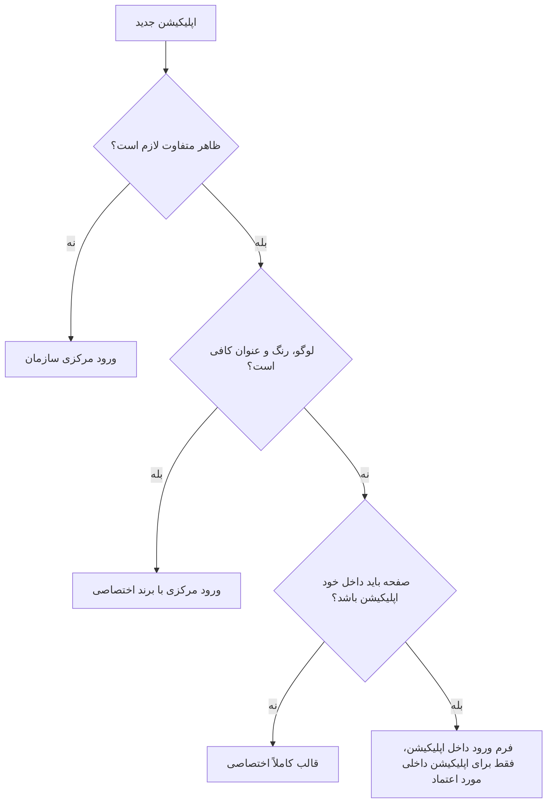
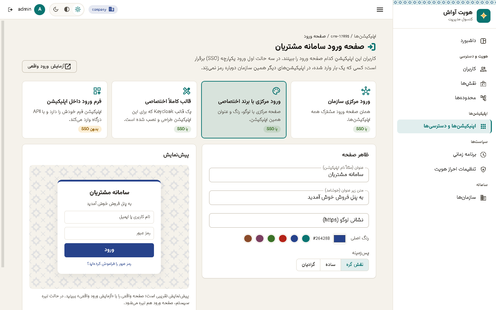
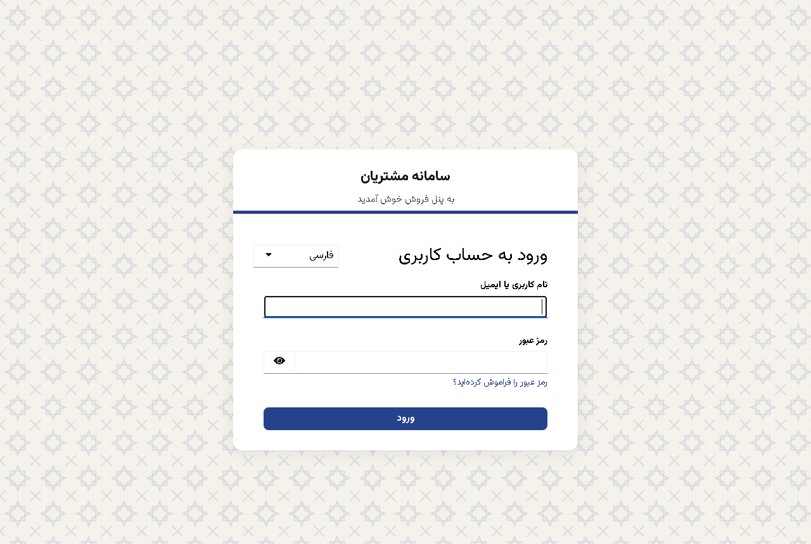
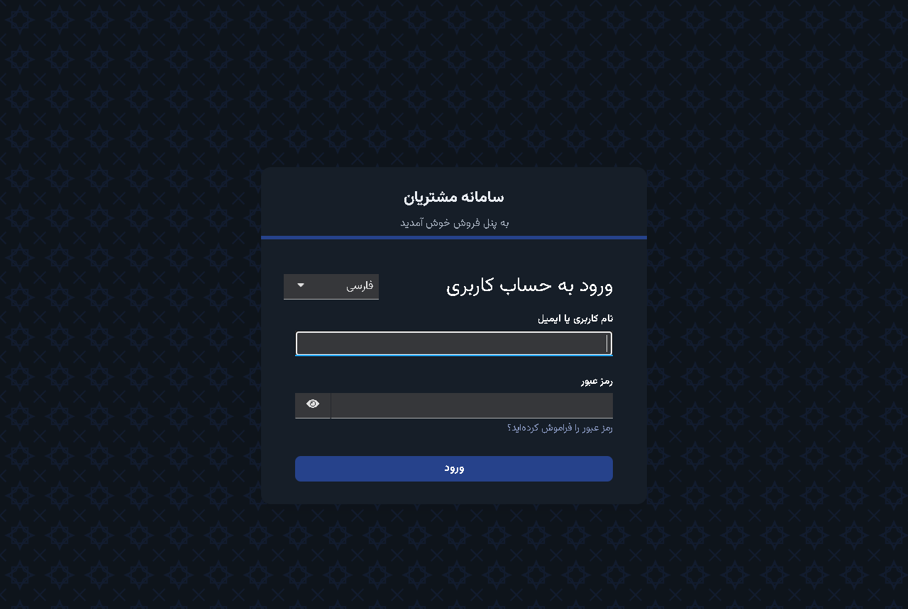

# صفحه ورود اپلیکیشن‌ها

هر اپلیکیشن خودش انتخاب می‌کند کاربرانش کدام صفحه ورود را ببینند: صفحه مرکزی سازمان، همان صفحه با برند خود اپلیکیشن، یک قالب کاملاً اختصاصی یا فرم ورود داخل خود اپلیکیشن. این انتخاب در کنسول، «اپلیکیشن‌ها ← صفحه ورود» انجام می‌شود و مثل بقیه تنظیمات فقط در Keycloak ذخیره می‌شود.

- [چهار حالت](#چهار-حالت)
- [کدام حالت را انتخاب کنم؟](#کدام-حالت-را-انتخاب-کنم)
- [ورود مرکزی با برند اختصاصی](#ورود-مرکزی-با-برند-اختصاصی)
  - [قواعد برند](#قواعد-برند)
- [قالب کاملاً اختصاصی](#قالب-کاملاً-اختصاصی)
  - [ساخت قالب از روی avash](#ساخت-قالب-از-روی-avash)
  - [نصب قالب](#نصب-قالب)
- [فرم ورود داخل اپلیکیشن](#فرم-ورود-داخل-اپلیکیشن)
- [صفحه ورود مرکزی سازمان](#صفحه-ورود-مرکزی-سازمان)
- [نحوه ذخیره در Keycloak](#نحوه-ذخیره-در-keycloak)

## چهار حالت

| حالت | کاربر چه می‌بیند | ورود یکپارچه (SSO) |
|---|---|---|
| ورود مرکزی سازمان (`inherit`) | صفحه ورود مشترک همه اپلیکیشن‌ها | دارد |
| ورود مرکزی با برند اختصاصی (`branded`) | همان صفحه با لوگو، عنوان، رنگ و پس‌زمینه اپلیکیشن | دارد |
| قالب کاملاً اختصاصی (`theme`) | یک قالب Keycloak که برای این اپلیکیشن طراحی شده | دارد |
| فرم ورود داخل اپلیکیشن (`embedded`) | فرمی که خود اپلیکیشن ساخته | ندارد |

در سه حالت اول، صفحه ورود را خود Keycloak نشان می‌دهد. کاربری که در یکی از اپلیکیشن‌ها وارد شده، در بقیه بدون رمز وارد می‌شود، حتی اگر ظاهر صفحه ورود هر اپلیکیشن متفاوت باشد. ورود دومرحله‌ای، قفل حساب، برنامه زمانی هفتگی و ورود با LDAP یا سرویس‌های بیرونی هم در همه این حالت‌ها یکسان کار می‌کند.

## کدام حالت را انتخاب کنم؟



بیشتر اپلیکیشن‌ها با «ورود مرکزی با برند اختصاصی» به همه نیازشان می‌رسند، بدون اینکه کسی قالب بنویسد یا نگه دارد.

## ورود مرکزی با برند اختصاصی

در کنسول، کارت «ورود مرکزی با برند اختصاصی» را انتخاب کنید و این‌ها را پر کنید:

- عنوان، مثلاً نام اپلیکیشن
- متن زیر عنوان، مثلاً یک خوشامد کوتاه
- نشانی لوگو (فقط `https`)
- رنگ اصلی دکمه‌ها و پیوندها (چند رنگ آماده ایرانی هم هست: فیروزه‌ای، لاجوردی، اناری، پسته‌ای، سماقی، سفالی)
- پس‌زمینه: نقش گره، ساده یا گرادیان

پیش‌نمایش کنار فرم تقریبی است. دکمه «آزمایش ورود واقعی» صفحه واقعی Keycloak را برای همین اپلیکیشن باز می‌کند (اپلیکیشن باید آدرس بازگشت داشته باشد).



صفحه واقعی، در حالت روشن و تیره سیستم:





### قواعد برند

درگاه این مقادیر را پیش از ذخیره بررسی می‌کند و قالب هم دوباره آن‌ها را چک می‌کند:

| فیلد | قاعده |
|---|---|
| عنوان | حداکثر ۶۰ نویسه، متن ساده (بدون `<`، ‏`>` و نویسه کنترلی) |
| متن زیر عنوان | حداکثر ۱۶۰ نویسه، متن ساده |
| لوگو | نشانی کامل `https` بدون فاصله، کوتیشن یا پرانتز |
| رنگ | قالب `#RRGGBB`؛ کنتراست متن سفید دکمه روی آن دست‌کم ۳ به ۱ (رنگ‌های خیلی روشن پذیرفته نمی‌شوند) |
| پس‌زمینه | ‏`pattern`، ‏`plain` یا `gradient` |

اگر حالت را عوض کنید، برند پاک نمی‌شود؛ با برگشتن به همین حالت دوباره نمایش داده می‌شود.

## قالب کاملاً اختصاصی

قالب اختصاصی یک قالب ورود (login theme) Keycloak است که با FreeMarker و CSS نوشته می‌شود. وقتی قالب روی سرور نصب شد، در کنسول در فهرست «قالب نصب‌شده» ظاهر می‌شود.

### ساخت قالب از روی avash

ساده‌ترین شروع، ارث‌بری از قالب `avash` است که فارسی، راست‌به‌چپ، با فونت وزیرمتن و حالت تیره است:

```text
keycloak/themes/crm/login/
├── theme.properties
├── resources/css/crm.css
└── resources/img/logo.svg
```

```properties
# keycloak/themes/crm/login/theme.properties
parent=avash
import=common/keycloak
locales=fa,en
rtlLanguageCodes=fa
darkMode=true
styles=css/styles.css css/avash.css css/crm.css
```

```css
/* keycloak/themes/crm/login/resources/css/crm.css */
:root { --avash-brand: #7B3F61; }
#kc-header-wrapper::before {
    content: "";
    display: block;
    height: 64px;
    background: url("../img/logo.svg") no-repeat center / contain;
}
```

برای تغییرهای بیشتر، فایل‌های `.ftl` قالب `keycloak.v2` را در پوشه قالب خود بازنویسی کنید. هر فایلی که بازنویسی شود با ارتقای Keycloak باید دوباره بررسی شود؛ برای همین `avash` فقط `footer.ftl` را بازنویسی کرده است، که Keycloak خودش برای همین کار گذاشته است.

### نصب قالب

- محیط توسعه: پوشه قالب را در `keycloak/themes` بگذارید. ‏AppHost این پوشه را در Keycloak سوار می‌کند و در حالت توسعه قالب‌ها cache نمی‌شوند.
- محیط عملیاتی: قالب را در یک فایل jar بسته‌بندی کنید (پوشه `theme/crm/login` به همراه `META-INF/keycloak-themes.json`) و در `providers` سرور Keycloak بگذارید، یا پوشه را در `/opt/keycloak/themes` قرار دهید و Keycloak را دوباره راه بیندازید.

## فرم ورود داخل اپلیکیشن

در این حالت اپلیکیشن فرم خودش را نشان می‌دهد و با شناسه و کلید خودش، `POST /api/identity/auth/login` درگاه را صدا می‌زند. نمونه درخواست در [راهنمای اتصال](integration.md#ورود-از-داخل-خود-اپلیکیشن) آمده است.

- فقط همین حالت «ورود مستقیم» (password grant) را برای اپلیکیشن روشن می‌کند. خروج از این حالت دوباره خاموشش می‌کند.
- برنامه زمانی هفتگی و محدوده‌های کاربر مثل بقیه حالت‌ها اعمال می‌شود.
- ورود یکپارچه، صفحه ورود دومرحله‌ای Keycloak و ورود با سرویس‌های بیرونی در این حالت نیست.
- رمز کاربر از دست اپلیکیشن عبور می‌کند و استاندارد OAuth 2.1 این روش را منسوخ می‌داند. این حالت را فقط برای اپلیکیشن‌های داخلی و مورد اعتماد انتخاب کنید.

کلاینت‌های خود درگاه (`identity-gateway`، ‏`identity-gateway-admin` و `identity-admin-console`) قابل تغییر نیستند.

## صفحه ورود مرکزی سازمان

صفحه مرکزی در «تنظیمات احراز هویت ← صفحه ورود» انتخاب می‌شود. قالب پیش‌فرض `avash` است. همه اپلیکیشن‌هایی که در حالت «ورود مرکزی سازمان» هستند، همین صفحه را نشان می‌دهند.

## نحوه ذخیره در Keycloak

| ویژگی کلاینت | معنا |
|---|---|
| ‏`iam.login.mode` | ‏`inherit`، ‏`branded`، ‏`theme` یا `embedded` |
| ‏`login_theme` | قالب ورود این اپلیکیشن؛ خالی یعنی قالب سازمان، `avash` در حالت برند |
| ‏`iam.login.title`، ‏`iam.login.subtitle` | عنوان و متن زیر آن |
| ‏`iam.login.logo_url`، ‏`iam.login.primary_color`، ‏`iam.login.background` | لوگو، رنگ و پس‌زمینه |
| ‏`directAccessGrantsEnabled` | ورود مستقیم؛ فقط در حالت `embedded` روشن است |

قالب `avash` این ویژگی‌ها را در `footer.ftl` از شیء `client` می‌خواند و در کارت ورود نشان می‌دهد. API مربوط در [خلاصه API](api.md#صفحه-ورود-هر-اپلیکیشن) آمده است.
